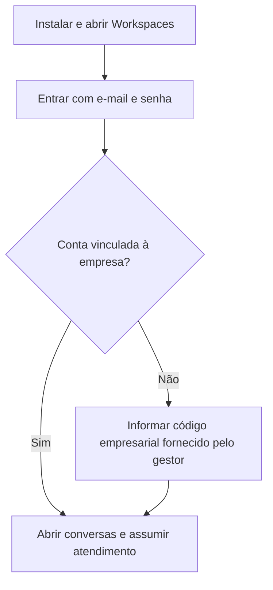

# Workspaces no Android e na Play Store

O projeto `android-workspace` gera um aplicativo Android instalável, com ícone próprio e nome **Workspaces**. Ele abre o atendimento em `https://workspaces-eta.vercel.app/atendimento` usando a interface responsiva do sistema dentro de uma WebView Android. É um app híbrido: precisa de internet e do site e serviços publicados. Não cria outro banco nem inclui credenciais de administrador no APK.

Compatibilidade mínima: Android 8.0 (API 26), com Android System WebView/Chrome atualizado (Chromium 111 ou superior). Provedores antigos mostram uma orientação de atualização em vez de uma tela vazia. Destino: Android 16 (API 36). Tablets, modo paisagem, teclado, recortes e barras de navegação são considerados pelo contêiner nativo. O projeto mantém o identificador de release `com.workspace.app`; se esse pacote já tiver uma publicação, use a chave de upload e a sequência de versões daquela publicação.

## 1. Baixar e instalar o APK pelo GitHub Actions

1. Abra [Actions → Workspaces Android (APK + Play Store)](https://github.com/Delta-1/WORKSPACES/actions/workflows/android-workspaces.yml).
2. Abra a última execução verde, ou clique em **Run workflow** na branch `main`. Deixe a URL vazia para usar o Workspaces Atendimento.
3. Em **Artifacts**, baixe **Workspaces-Android-APK-teste** e extraia o ZIP.
4. No Android, abra **Workspaces-teste.apk**. Se o aparelho solicitar, permita a instalação por aquele navegador ou gerenciador de arquivos.
5. Abra **Workspaces Teste** no celular.

O APK de teste tem o pacote `com.workspace.app.debug`. Ele pode coexistir com a versão da Play Store. Sua assinatura é de depuração: entre execuções pode ser necessário desinstalar a versão de teste antiga. Para atualizações contínuas use o APK de release com a mesma chave, ou a Play Store.

## 2. Como o funcionário entra



Use a mesma conta do site. No primeiro acesso, crie a conta individual caso necessário e confirme o e-mail quando solicitado. O gestor fornece o código empresarial e revisa setor e permissões em **Funcionários**. A sessão fica no armazenamento privado do aplicativo; ao sair da conta ou limpar os dados do app será necessário entrar novamente.

O menu **⋮ → Manual do funcionário** abre o [guia ilustrado](https://workspaces-eta.vercel.app/ajuda/atendimento). O botão **↻** tenta carregar novamente. O botão Voltar do Android retorna na navegação antes de fechar o app.

O caminho recomendado no aplicativo é e-mail/senha. O login Google no navegador externo tem sessão separada e não autentica automaticamente a WebView. Esta versão não implementa retorno OAuth nativo.

## 3. Anexos, áudio e arquivos

- **Anexar** abre o seletor de arquivos do Android, sem pedir acesso amplo ao armazenamento.
- O microfone é solicitado quando a página precisa gravar áudio. A permissão é limitada ao endereço HTTPS do Workspaces; câmera e outros recursos não são concedidos por esse fluxo.
- **Baixar** nos anexos de conversa abre **Salvar como** para arquivos de até 16 MB. Para arquivos maiores, use **⋮ → Abrir no navegador**. Requer Android System WebView atualizado com suporte a mensagens por origem.
- Relatórios em janela separada têm **Imprimir / salvar PDF**.
- Não há notificações push nativas nem garantia de atualização de conversas com o aplicativo fechado nesta versão. Atendimento ativo depende do app aberto e conectado.
- Recursos do chat, incluindo editar e apagar para todos, dependem também da versão do serviço WhatsApp. O APK não atualiza esse serviço.

## 4. Gerar o AAB assinado para a Play Store

A execução padrão entrega o APK de teste e **Workspaces-AAB-sem-assinatura**. Esse AAB é uma saída de compilação e **não está pronto para envio à Play Store**. A assinatura de produção usa uma chave de upload estável da sua empresa.

### Criar ou reutilizar a chave de upload

Se o app já existe na Play Console, reutilize sua chave de upload. Para um app novo, execute em um computador seguro com Java instalado:

```sh
keytool -genkeypair -v -keystore workspaces-upload.jks -alias workspaces-upload -keyalg RSA -keysize 3072 -validity 10000
```

Guarde o `.jks`, o alias e as senhas em local seguro. Não envie a chave ao repositório nem ao chat. Gere o texto Base64 do arquivo e coloque-o diretamente no secret; Linux: `base64 -w 0 workspaces-upload.jks`; macOS: `base64 -i workspaces-upload.jks | tr -d '\n'`. No PowerShell: `[Convert]::ToBase64String([IO.File]::ReadAllBytes('workspaces-upload.jks'))`.

Em **GitHub → Settings → Secrets and variables → Actions → New repository secret**, configure:

| Secret | Conteúdo |
|---|---|
| `ANDROID_KEYSTORE_BASE64` | Arquivo `.jks` convertido para Base64 em uma única linha |
| `ANDROID_KEYSTORE_PASSWORD` | Senha do arquivo de chave |
| `ANDROID_KEY_ALIAS` | Alias usado na criação; por exemplo `workspaces-upload` |
| `ANDROID_KEY_PASSWORD` | Senha da chave; em PKCS12 normalmente igual à senha do arquivo |

Execute novamente o workflow e marque **sign_release**. Os secrets são lidos apenas pelo processo de assinatura; o arquivo temporário é removido no final e não vai aos artifacts. Se faltar qualquer secret, a execução de release falha sem criar um pacote que pareça assinado.

A saída **Workspaces-PlayStore-assinado** contém:

| Arquivo | Uso |
|---|---|
| `Workspaces.apk` | Instalação direta da versão de release, assinada pela chave de upload |
| `Workspaces-playstore.aab` | Envio à Play Console com Play App Signing |

O Play App Signing pode assinar os APKs entregues pela loja com uma chave diferente da chave de upload. Nesse caso, a instalação direta e a instalação da loja não se atualizam mutuamente: distribua pelo mesmo canal ou desinstale antes de trocar.

A versão padrão é `1.1.0`. O `versionCode` automático é `100000 + número da execução` deste workflow. Se houver uma versão anterior com código maior, preencha **version_code** com um inteiro maior que o último aceito pela loja; nas próximas execuções continue usando códigos crescentes. O relatório **Workspaces-Android-validacao** contém o lint e os hashes SHA-256 dos pacotes.

## 5. Enviar à Play Store

1. Na sua conta de desenvolvedor da **Play Console**, crie ou abra o app correspondente ao pacote `com.workspace.app`.
2. Configure **Play App Signing** e envie o `Workspaces-playstore.aab` assinado para **Teste interno**.
3. Complete nome, descrição, ícone, capturas de tela, contato de suporte, classificação, público, política de privacidade e Segurança dos dados conforme o uso real da empresa. Forneça à revisão uma conta de demonstração e as instruções de acesso, sem dados de clientes.
4. Valide em celulares reais: login, empresa, atendimento, teclado aberto, anexos, microfone, download, reconexão, edição e exclusão. Faça testes de WhatsApp apenas com destinatário autorizado.
5. Envie a versão para revisão quando estiver pronta. A aprovação e eventuais testes exigidos dependem da sua conta e das políticas da Google.

O workflow gera os arquivos; **não envia nem publica automaticamente na Play Store**. A conta de desenvolvedor, chave de upload e dados da ficha são necessários para finalizar a publicação.

## Desenvolvimento e verificação

Java 17, Gradle 8.11.1, Android SDK 36 e build-tools 35.0.0. Na pasta `android-workspace`:

```sh
gradle --no-daemon :app:lintRelease :app:assembleDebug :app:bundleRelease
```

O workflow também instala o APK real em emuladores API 26 e 36 e verifica abertura, controles nativos, recriação de Activity, isolamento de origem, configuração da WebView e ausência de permissão antecipada de microfone. Em WebViews atuais, espera também o formulário real de login após recriar a Activity; em versões antigas, exige a orientação de atualização. As capturas e resultados ficam em **Workspaces-Android-smoke-API-26/36**. Esses testes de abertura não comprovam atendimento completo, entrega WhatsApp ou funcionamento em todos os aparelhos físicos.

Referências oficiais: [assinatura Android](https://developer.android.com/studio/publish/app-signing), [envio do App Bundle](https://developer.android.com/studio/publish/upload-bundle), [API exigida pelo Google Play](https://developer.android.com/google/play/requirements/target-sdk).
